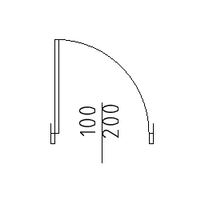

# arDoor2D

Simple 2D parametric door to be used in line drawings.

**Source:** [`Library_Src/2D/arDoor2D/`](../../Library_Src/2D/arDoor2D/) · [Wiki](https://github.com/malamalca/ar_library/wiki/2D-Objects)

## Parameters

| Parameter | Meaning |
|-----------|---------|
| `A` / `B` | Door width / reveal depth |
| `doorType` | Single or double door |
| `doorWidth` | Width of one leaf (double doors); hidden for single doors |
| `revealOutsideLength` | Outside reveal length |
| `revealInsideLength` | Inside reveal length |
