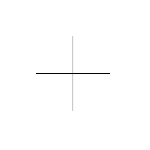

# arKriž

Simple 2D cross object. Draws a cross (or a square outline, depending on `kind`) with hotspots on the arms for direct editing.

**Source:** [`Library_Src/2D/arKriž/`](../../Library_Src/2D/arKriž/) · [Wiki](https://github.com/malamalca/ar_library/wiki/2D-Objects)

## Parameters

| Parameter | Meaning |
|-----------|---------|
| `A` / `B` | Cross arm lengths |
| `kind` | 0 = cross, otherwise square outline |
