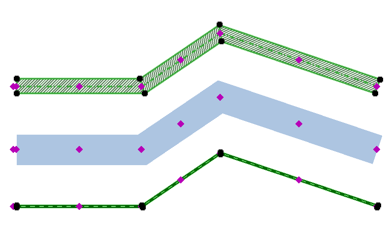

# arPolyline

Object used for drawing a double (2x) polyline. The polyline can have thickness, offset lines and fill. Max 50 points; nodes are added by dragging the add-node hotspot.

**Source:** [`Library_Src/2D/arPolyline/`](../../Library_Src/2D/arPolyline/) · [Wiki](https://github.com/malamalca/ar_library/wiki/2D-Objects)

## Parameters

| Parameter | Meaning |
|-----------|---------|
| `x`, `y` | Node coordinates (n points) |
| `total_length` | Total polyline length (locked, computed) |
| `showaxis` / axis pen & line type | Centerline display |
| `polylinetype`, `polypen` | Line type / pen of the outline |
| `showoffset`, `offset` | Offset lines distance |
| `offsetkind` | Custom / Center / Left / Right offset |
| `showseparatorlines` | All / None / Startline Only / Endline Only / Start and Endline |
| `usefill`, `polyfill`, `polyfillpen`, `polyfillbgpen` | Fill and its pens |
| `polyfillalign`, `polyfillcategory` | Fill alignment, Draft / Cut / Cover category |
| `distortfill`, `fillorigindeltaX/Y`, `fillscaleX/Y` | Fill distortion options |
