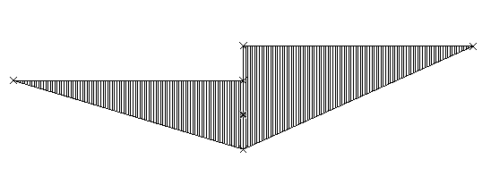

# arPregledniTrikotnik

This object is used in the design of road junctions. It represents a visibility (sight) triangle with an arbitrary sight distance, computed from a built-in stopping-distance table for level slopes (−12 % to +12 %) and design speeds (30–130 km/h).

**Source:** [`Library_Src/2D/arPregledniTrikotnik/`](../../Library_Src/2D/arPregledniTrikotnik/) · [Wiki](https://github.com/malamalca/ar_library/wiki/2D-Objects)

## Parameters

| Parameter | Meaning |
|-----------|---------|
| `iSpeed` | Design speed (30–130 km/h) |
| `iSlope` | Level slope (−12 % to +12 %) |
| `stoppingDistance` | Resulting stopping distance, read from the table |
| `fontFace` | Text font |
