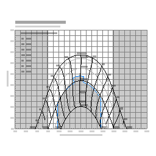

# arShadingChart

Shading chart. Draws a horizontal shading diagram for an [ar3DPolygon](../3D/ar3DPolygon.md) base (building outline): sun rays per hour/month are projected onto the plan to show shaded areas.

**Source:** [`Library_Src/2D/arShadingChart/`](../../Library_Src/2D/arShadingChart/) · [Wiki](https://github.com/malamalca/ar_library/wiki/2D-Objects)

## Parameters

| Parameter | Meaning |
|-----------|---------|
| `axisFont`, `legendFont`, `fontChartTitle`, `basePointFont` | Fonts for axes, legend, title, base point |
| `gridSpacing` | Chart grid spacing |
| `showOutline`, `penOutline`, `lineOutline` | Object outline display |
| `showRays`, `penRay`, `lineRay` | Sun ray display |
