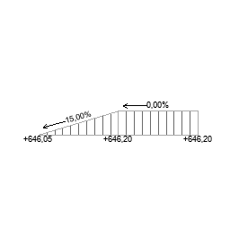

# arSlopePoly

This object is intended to display road and terrain slopes with multiple segments. Each segment between two nodes has its own slope in percent; the total elevation gain of all segments is computed automatically. Nodes are added / removed with UI buttons (max 20 points).

**Source:** [`Library_Src/2D/arSlopePoly/`](../../Library_Src/2D/arSlopePoly/) · [Wiki](https://github.com/malamalca/ar_library/wiki/2D-Objects)

## Parameters

| Parameter | Meaning |
|-----------|---------|
| `xyz` | Node coordinates (n nodes) |
| `slopes` | Slope per segment in % (segment i connects node i and i+1) |
| `totalElevation` | Total elevation gain of all segments (locked, computed) |
| `fontFace` | Text font |

UI proxy fields: `ui_node_index`, `ui_node_x/y`, `ui_segment_index`, `ui_segment_slope`.
