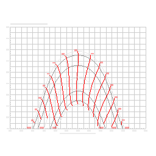

# arSunChart

Movement of the sun for a specified geographical location. Draws a solar altitude / azimuth chart (sun path diagram) with month and hour curves, using standard solar-position formulas from latitude, longitude and solar time zone offset.

**Source:** [`Library_Src/2D/arSunChart/`](../../Library_Src/2D/arSunChart/) · [Wiki](https://github.com/malamalca/ar_library/wiki/2D-Objects)

## Parameters

| Parameter | Meaning |
|-----------|---------|
| `latitude` | Site latitude in degrees |
| `longitude` | Site longitude in degrees |
| `dTgmt` | Solar time zone offset (hours from GMT) |
| `gridSpacing` | Chart grid spacing |
