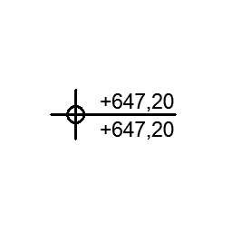

# arVišinskaKota

Absolute height dimension point with two lines. Dimension point that shows a custom or computed elevation (project zero, reference levels 1–2, altitude), drawn from top or bottom of the point, in two line styles.

**Source:** [`Library_Src/2D/arVišinskaKota/`](../../Library_Src/2D/arVišinskaKota/) · [Wiki](https://github.com/malamalca/ar_library/wiki/2D-Objects)

## Parameters

| Parameter | Meaning |
|-----------|---------|
| `delta_z` | Elevation offset from the placement point |
| `sel_style` / `sel_style_u` | None, Custom, Top/Bottom to Project Zero, Reference Level 1 or 2, Altitude (two variants) |
| `custom_string`, `custom_string_u` | Custom text when style is Custom |
| `t_font` | Text font |
