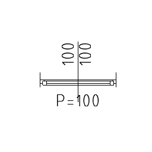

# arWindow2D

Simple 2D parametric window to be used in line drawings. Draws outer and inner frames with hotspots for width and frame depth editing.

**Source:** [`Library_Src/2D/arWindow2D/`](../../Library_Src/2D/arWindow2D/) · [Wiki](https://github.com/malamalca/ar_library/wiki/2D-Objects)

## Parameters

| Parameter | Meaning |
|-----------|---------|
| `A` / `B` | Window width / reveal depth |
| `revealOutsideLength` | Outside reveal length |
| `revealInsideLength` | Inside reveal length |
| `markerFont`, `markerFontSize` | Marker text style |
