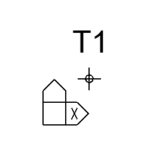

# arZakoličba

Custom surveying point. Point object that reports its coordinates relative to the world origin (with optional base offsets), rounded to millimetres; Z can be taken from the project altitude instead of a base elevation.

**Source:** [`Library_Src/2D/arZakoličba/`](../../Library_Src/2D/arZakoličba/) · [Wiki](https://github.com/malamalca/ar_library/wiki/2D-Objects)

## Parameters

| Parameter | Meaning |
|-----------|---------|
| `base_x`, `base_y` | Coordinate base offset (X/Y) |
| `delta_x`, `delta_y` | Offset from the placement point, rotated with the object |
| `base_z` | Elevation base (hidden when `use_project_z`) |
| `use_project_z` | Use project altitude for Z instead of `base_z` |
| `coord_x`, `coord_y`, `coord_z` | Computed coordinates (locked) |
