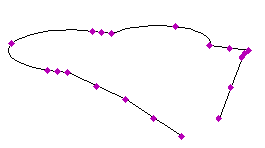

# eGPilon

Not implemented yet. Pilot object for the eG parcel polygon: three closed polylines (ground boundary, building projection, basement below terrain level) with per-story display options and position / height accuracy classes. Generates an XML document (`eGStavba.xml`) containing JSON with WKT `POLYGON` geometry of all three contours and building heights.

**Source:** [`Library_Src/2D/eGPilon/`](../../Library_Src/2D/eGPilon/) · [Wiki](https://github.com/malamalca/ar_library/wiki/2D-Objects)

## Parameters

| Parameter | Meaning |
|-----------|---------|
| `polyKind` | Stik z zemljiščem (ground), Projekcija (projection), Pod nivojem terena (below terrain) |
| `buildingEqualsBase`, `basementEqualsBase` | Reuse the ground polygon for projection / basement |
| `polozajnaTocnost` | Position accuracy: ±0,25 m / ±1,0 m / ±2,5 m |
| `visinskaTocnost` | Height accuracy: ±0,25 m / ±0,35 m / 1,0 m / > 1,0 m |
| `total_length` | Perimeter of the active polygon (locked) |
| `xml`, `json` | Generated export data (locked) |
