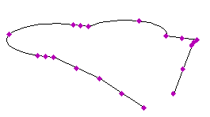

# ar3DPolygon



3D polygon. Not placeable — used by other objects (arShadingChart, arPrismVolume, arSlopedPlane, arObjectOnPolyline). Manages an editable chain of up to 20 3D nodes: dragging the add-node hotspot inserts a node, zero-length segments are cleaned up automatically.

**Source:** [`Library_Src/3D/ar3DPolygon/`](../../Library_Src/3D/ar3DPolygon/) · [Wiki](https://github.com/malamalca/ar_library/wiki/3D-Objects)

## Parameters

| Parameter | Meaning |
|-----------|---------|
| `xyz` | Node coordinates (n nodes, max 20) |
| `n` | Number of active nodes |
| `xyz_e` | Edit proxy for node insertion (hotspot drag) |

Called by other objects as:

```gdl
call "ar3DPolygon" parameters n = n, xyz = xyz, xyz_e = xyz_e, xyz_ea = xyz_ea
    returned_parameters unId
```
