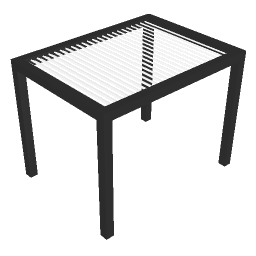

# arBioklimatskaPergola

Simple awning object (bioclimatic pergola). Rectangular footprint A × B with a louvered top surface in 3D.

**Source:** [`Library_Src/3D/arBioklimatskaPergola/`](../../Library_Src/3D/arBioklimatskaPergola/) · [Wiki](https://github.com/malamalca/ar_library/wiki/3D-Objects)

## Parameters

| Parameter | Meaning |
|-----------|---------|
| `A` / `B` | Footprint width / depth |
