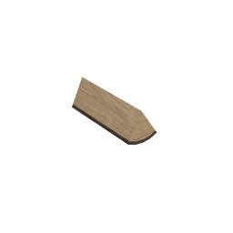

# arFireplaceLog

Simple fireplace log for interior decoration. A cylindrical log lying across the fireplace, with optional bark (crust) material and 3D detail level.

**Source:** [`Library_Src/3D/arFireplaceLog/`](../../Library_Src/3D/arFireplaceLog/) · [Wiki](https://github.com/malamalca/ar_library/wiki/3D-Objects)

## Parameters

| Parameter | Meaning |
|-----------|---------|
| `A` / `B` | Log length / diameter (ZZYZX = A) |
| `angle` | Rotation around the long axis (0–360°) |
| `show_3d` | none / simple / detailed |
| `mat_crust`, `crust_width` | Bark material and thickness (detailed only) |
