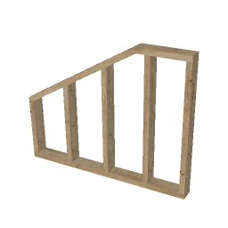

# arFrame

Framing object. Parametric stud wall frame: vertical studs placed along the length (max 100), bottom / top plates, per-bay blocking (horizontals) and support posts. Studs are added with a hotspot; extending the frame auto-fills new studs at the default spacing, shortening drops the ones left outside. All parameters are edited in the custom interface only.

**Source:** [`Library_Src/3D/arFrame/`](../../Library_Src/3D/arFrame/) · [Wiki](https://github.com/malamalca/ar_library/wiki/3D-Objects)

## Parameters

| Parameter | Meaning |
|-----------|---------|
| `A` / `B` | Frame length / width (stud spacing direction × frame depth) |
| `n`, `X` | Stud count and stud axis positions |
| `defaultStudSpacing` | Spacing used when the frame is extended |
| `bottomElementHeight`, `topElementHeight` | Bottom / top plate height |
| `defaultStudWidth`, `firstStudWidth`, `lastStudWidth` | Stud widths (end studs optional) |
| `supportPostWidth` | Support post width |
| `lumberVol`, `frameArea` | Computed lumber volume / frame area |
| `frameViewFont` | Font for elevation-view dimensions |

### Frame types

The part **arFrameTypes** returns the type table as two arrays of fixed size (20 types, 7 sizes each). It is **not** in this library: every project adds its own copy to its embedded library (example in [`Examples/arFrameTypes/`](../../Examples/arFrameTypes/)), so each project has its own list of types. Without it there is simply no Frame Type pop-up.

Calling a part that is missing freezes ArchiCAD, so arFrame first asks `LIBRARYGLOBAL` for the marker parameter `isFrameTypesTable` (= 1) before calling it by name. The table rows map to:

| Column | Meaning |
|--------|---------|
| 1 | frame width B |
| 2 | bottom plate height |
| 3 | top plate height |
| 4 | stud width |
| 5 | first stud width |
| 6 | last stud width |
| 7 | support post width |

All sizes in meters. The selected type takes over its dimensions (they become hidden); "Po meri" (custom) keeps them editable. A type that no longer exists falls back to custom.

### Blocking (horizontals) editor

Per bay (the bay to the right of stud i), up to 3 horizontal pieces stored as absolute Z heights (`horizontals[bay][1..3]`, 0 = none), each with depth, height and Y shift (`horizontalsDim`), plus per-bay flags: omit bottom plate, omit top plate, extra vertical bar left / right. UI proxy fields: `ui_hz_bay`, `ui_hz_1..3`, `ui_hz_showBot/Top`, `ui_hz_vL/vR`, `ui_hz_d1..3/h1..3/y1..3`.
