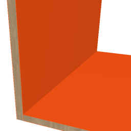

# arIveralPanel

Panel used for furniture. It can be rotated (0–90°). Panel with configurable edge borders on all four sides and a material type; reports length in millimetres and a border code for scheduling.

**Source:** [`Library_Src/3D/arIveralPanel/`](../../Library_Src/3D/arIveralPanel/) · [Wiki](https://github.com/malamalca/ar_library/wiki/3D-Objects)

## Parameters

| Parameter | Meaning |
|-----------|---------|
| `A` / `ZZYZX` | Panel length (horizontal / vertical placement) |
| `angle` | Rotation 0–90°; switches which dimension drives the length |
| `borderLeft/Right/Front/Back` | None / Standard .8 mm / ABS 2 mm per side |
| `matType` | Iveral, Pult, Lesomal, Akril Sijaj, Vezana Plošča |
| `panelLength`, `panelLenghtMM` | Computed length (m / mm), locked |
| `borderCode` | Computed 4-digit border code, locked |
| `scheduleFont` | Schedule text font |
