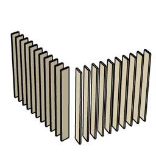

# arObjectOnPolyline

Object used to draw an array of other objects or profiles on a specified polyline path (3D nodes via [ar3DPolygon](ar3DPolygon.md)). Objects are placed at the nodes or distributed along the path.

**Source:** [`Library_Src/3D/arObjectOnPolyline/`](../../Library_Src/3D/arObjectOnPolyline/) · [Wiki](https://github.com/malamalca/ar_library/wiki/3D-Objects)

## Parameters

| Parameter | Meaning |
|-----------|---------|
| `xyz` | Path nodes (n nodes) |
| `object_kind` | Rectangle / Circle / Complex Profile |
| `object_distribution` | No of objects between nodes / Minimal distance / Fixed distance |
| `distribution_no`, `distribution_minspacing` | Count or spacing for the distribution mode |
| `profile` | Complex profile (profile kind only) |
| `total_length` | Total path length (locked, computed) |
