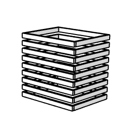

# arProfileMultiplicator

Object used to multiply a complex profile in vertical or horizontal directions. Reads the components of an arbitrary complex profile (pens, line types, fills) and repeats it into a grid / stack.

**Source:** [`Library_Src/3D/arProfileMultiplicator/`](../../Library_Src/3D/arProfileMultiplicator/) · [Wiki](https://github.com/malamalca/ar_library/wiki/3D-Objects)

## Parameters

| Parameter | Meaning |
|-----------|---------|
| `profile` | Complex profile to multiply |
| `A`, `B`, `ZZYZX` | Extents of the multiplied body |
| count / spacing parameters | Number and pitch of copies per direction |
