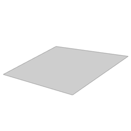

# arSlopedPlane

Slope plane object used for designing sloped grounds. The plane is defined either by an inclination angle with a direction vector (arrow, high / low point selectable) or by the first three points of an [ar3DPolygon](ar3DPolygon.md) node chain.

**Source:** [`Library_Src/3D/arSlopedPlane/`](../../Library_Src/3D/arSlopedPlane/) · [Wiki](https://github.com/malamalca/ar_library/wiki/3D-Objects)

## Parameters

| Parameter | Meaning |
|-----------|---------|
| `mode` | Naklonski vektor (inclination vector) / Prve 3 točke (first 3 points) |
| `slopeInclination` | Inclination in % (vector mode; recomputed from 3 points) |
| `startFromTop` | Which end of the arrow is the high point |
| `slopeArrow1X/Y`, `slopeArrow2X/Y` | Direction vector endpoints |
| `xyz` | Node chain (3-point mode, via ar3DPolygon) |
| `fontFace` | Text font |
