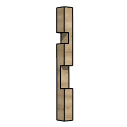

# arTimber

Object to display a timber post with arbitrary cutouts. Vertical or horizontal post with up to 10 cuts, each one-sided or L-shaped, with its own distance from the end, height, thickness and rotation (snapped to 0/90/180/270°). Cuts are added by dragging the add-cut hotspot.

**Source:** [`Library_Src/3D/arTimber/`](../../Library_Src/3D/arTimber/) · [Wiki](https://github.com/malamalca/ar_library/wiki/3D-Objects)

## Parameters

| Parameter | Meaning |
|-----------|---------|
| `orientation` | Vertical / Horizontal |
| `A`, `B` | Cross-section (vertical: length = ZZYZX; horizontal: length = hor_length) |
| `n` | Number of cuts (max 10) |
| `cut_lengths[i]` | Per cut: distance from end, height, thickness 1 / thickness 2 |
| `cut_kinds[i]` | One-sided / L-shaped |
| `cut_rotations[i]` | Cut rotation, snapped to quarter turns |
| `timber_size` | Length in mm (locked, for schedules) |
