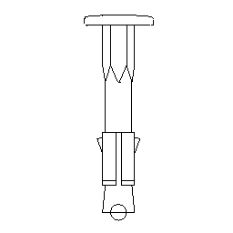

# arKnaufAnchor

Simple wall/concrete anchor drawing. Detail symbol of a Knauf wall / concrete anchor, drawn to scale for detail sheets.

**Source:** [`Library_Src/Details/arKnaufAnchor/`](../../Library_Src/Details/arKnaufAnchor/) · [Wiki](https://github.com/malamalca/ar_library/wiki/Details)
