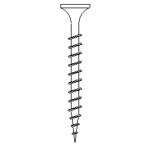

# arKnaufScrew

Simple screw drawing. Detail symbol of a Knauf drywall screw (TN 3.5×35), drawn to scale for detail sheets.

**Source:** [`Library_Src/Details/arKnaufScrew/`](../../Library_Src/Details/arKnaufScrew/) · [Wiki](https://github.com/malamalca/ar_library/wiki/Details)
