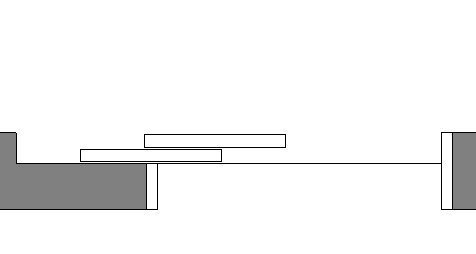

# arElevatorDobleDoor

Simple double sliding door for elevator access. Wall element with a door pocket in the wall: two sliding panels in front of the opening, opening width set by hotspot drag or parameter.

**Source:** [`Library_Src/Doors/arElevatorDobleDoor/`](../../Library_Src/Doors/arElevatorDobleDoor/) · [Wiki](https://github.com/malamalca/ar_library/wiki/Doors)

## Parameters

| Parameter | Meaning |
|-----------|---------|
| `A` | Opening width (wall element) |
| `open_width` | Sliding open width (range limited by frame and pocket) |
| `frame_width` | Door frame width |
| `pocket_offset`, `side_offset` | Pocket / side offsets of the niche |
