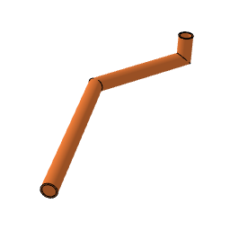

# arCevniRazvod

Horizontal pipe line. Multi-segment horizontal MEP run: each segment has a length and direction (angles snap to 15° increments), junctions at nodes with their own angle, length and width. Segments are inserted / deleted through the UI or hotspots; offset lines can be shown from a given drawing scale up.

**Source:** [`Library_Src/MEP/arCevniRazvod/`](../../Library_Src/MEP/arCevniRazvod/) · [Wiki](https://github.com/malamalca/ar_library/wiki/MEP)

## Parameters

| Parameter | Meaning |
|-----------|---------|
| `A` | Pipe diameter (also the minimum segment length) |
| `nSegments`, `segments`, `directions` | Segment lengths and turn angles |
| `junctions`, `junctionLengths`, `junctionWidths` | Per-node junction data |
| `mepKind` | Nedefinirano, Fekalije, Meteorna, Meteorna-Ceste, Drenaža, Voda, Elektrika, Telekomunikacije, Plin, Ogrevanje, Razsvetljava, Prezračevanje |
| `offsetShow` | Offset lines: never / from 1:500 … 1:10 / always |
| `lockAngles` | Snap segment and junction angles |
| `totalLength`, `totalLength3D` | Computed lengths (locked) |
| `textFont` | Text font |

UI proxy fields: `ui_node_index`, `ui_node_segment_length`, `ui_node_direction`, `ui_node_junction(_length/_width)`.
