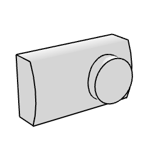

# arFasadnaRešetka

Facade ventilation box (intake+exhaust). Wall-mounted outdoor ventilation unit with curved casing, pipe connections and a slatted front; 2D symbol plus 3D body.

**Source:** [`Library_Src/MEP/arFasadnaRešetka/`](../../Library_Src/MEP/arFasadnaRešetka/) · [Wiki](https://github.com/malamalca/ar_library/wiki/MEP)

## Parameters

| Parameter | Meaning |
|-----------|---------|
| `A`, `B`, `ZZYZX` | Unit width / height / depth (locked by default) |
| `pipeDistance`, `pipeInternalDiameter` | Pipe connection position and diameter |
