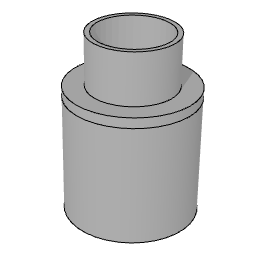

# arJašek

Simple shaft object. Generic manhole / shaft (jašek): round or rectangular, custom size or standard round size with matching wall width, plus a cover type (round, square, rectangular). Base for the specialized variants [arMKČN](arMKČN.md), [arPonikovalnica](arPonikovalnica.md) and [arVodomerniJašek](arVodomerniJašek.md), which call it with `CALL "arJašek" PARAMETERS ALL`.

**Source:** [`Library_Src/MEP/arJašek/`](../../Library_Src/MEP/arJašek/) · [Wiki](https://github.com/malamalca/ar_library/wiki/MEP)

## Parameters

| Parameter | Meaning |
|-----------|---------|
| `kind` | Brez (none) / Okrogla po meri (custom round) / Pravokotna po meri (custom rectangle) / Okrogla tipska (standard round) |
| `A`, `B` | Shaft dimensions (B hidden unless rectangular) |
| `standardSize` | Standard size index (sets A and the wall width) |
| `wallWidth` | Wall width around a standard shaft (locked) |
| `latchKind` | Okrogel / Kvadraten / Pravokoten pokrov (cover shape) |
| `latchSizeB` | Rectangular cover B dimension |
