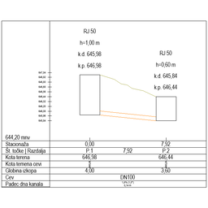

# arKanalizacija

Pipe path with longitudinal section. The main drainage object: a 3D pipe path (via [ar3DPolygon](../3D/ar3DPolygon.md)) that carries per-segment pipe diameters and shafts ([arKanalizacijaJašek](arKanalizacijaJašek.md)). Each shaft has dimensions, cover data, bottom / cover elevations (project or absolute), a cascade option, caption lines, and up to several extra inlets / outlets. The 2D longitudinal section (profile) is generated automatically with a grid, slopes and text; the companion [arProfilKanalizacije](arProfilKanalizacije.md) draws profile-only views.

**Source:** [`Library_Src/MEP/arKanalizacija/`](../../Library_Src/MEP/arKanalizacija/) · [Wiki](https://github.com/malamalca/ar_library/wiki/MEP)

## Parameters (main)

| Parameter | Meaning |
|-----------|---------|
| `xyz`, `n` | Path nodes |
| `pipeDimensions[i]` | Pipe diameter per segment |
| `shaftDataDimensions[i][]` | Per shaft: height, dim1/dim2, cover dims, inlet/outlet heights, marker position, raise height |
| `shaftDataOptions[i][]` | Per shaft: show shaft, shaft type, cover type, cascade |
| `shaftProfileTexts`, `shaftCaptionLinesShow` | Profile caption text and shown lines per shaft |
| `shaftPortTypes/Angles/Heights/Diameters` | Extra inlets / outlets (Vtok/Iztok) per shaft |
| `elevZeroAbs` | Absolute elevation of project 0.00 |
| `totalLength` | Path length (locked) |
| `showPipeCaption`, `showShaftCaption` | Always / Never / By MVO |
| `pipeCaptionTextFont/Size/Pen/Style`, `shaftCaptionText*`, `profileText*` | Text styles (MVO-driven variants lockable) |
| `show3D`, `surface_mat`, `coverMat`, `pipeMat` | 3D display and materials |

UI proxy fields: `ui_pipe_index/diameter`, `ui_shaft_index`, `ui_shaft_dim1/height/raise/cascade/bottom_abs/bottom_prj/cover_abs/cover_prj/profile_text/line1..4`, `ui_port_index/type/angle/height/diameter`.
