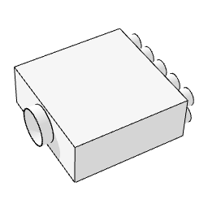

# arPrezračevanjeRazdelilec

Ventilation air splitter. Box that splits an intake duct (diameter set by the connected pipe) into branches; A × B footprint with the intake stub on top.

**Source:** [`Library_Src/MEP/arPrezračevanjeRazdelilec/`](../../Library_Src/MEP/arPrezračevanjeRazdelilec/) · [Wiki](https://github.com/malamalca/ar_library/wiki/MEP)

## Parameters

| Parameter | Meaning |
|-----------|---------|
| `A`, `B` | Box width / depth |
| `ZZYZX` | Height (min = intake diameter + 0.01 m) |
| `intakeDiameter` | Intake duct diameter (from the connected pipe) |
