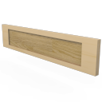

# arStairRiser

Riser component for ArchiCAD stairs. Placed on a stair as an accessory; draws the riser with optional reveal, own cut line / uncut line pens, building material and surface overrides (riser surface, cut surfaces, cut fill pens). Uses the `STAIR2D_*` global constants of the host stair.

**Source:** [`Library_Src/Stairs/arStairRiser/`](../../Library_Src/Stairs/arStairRiser/)

## Parameters (main)

| Parameter | Meaning |
|-----------|---------|
| reveal option + dimension | Riser reveal above/below |
| `STAIR2D_*` pens / line types | Uncut / cut line, override pens |
| building material / surface overrides | Material and surface settings |
