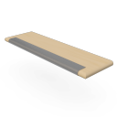

# arStairTread

Tread component for ArchiCAD stairs. Placed on a stair as an accessory; draws the tread with optional nosing profile, recesses, non-slip bands and raised strip. Uses the `STAIR2D_*` global constants of the host stair.

**Source:** [`Library_Src/Stairs/arStairTread/`](../../Library_Src/Stairs/arStairTread/)

## Parameters (main)

| Parameter | Meaning |
|-----------|---------|
| nosing profile option / dimension | Tread nosing |
| recess options | Recesses in the tread |
| non-slip band / raised strip options | Safety features |
| `STAIR2D_*` pens / line types | Uncut / cut line, override pens |
