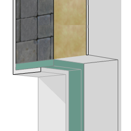

# arInsulatedReveal

Insulated reveal and window board. Reveal (gap between window frame and wall) with insulation, plaster runs on each side (left / right / top / bottom toggles), optional corner angles, and an optional interior window board — either a default rectangular board or a custom complex profile.

**Source:** [`Library_Src/Windows/arInsulatedReveal/`](../../Library_Src/Windows/arInsulatedReveal/) · [Wiki](https://github.com/malamalca/ar_library/wiki/Windows)

## Parameters (main)

| Parameter | Meaning |
|-----------|---------|
| `length_insulation` | Insulation length (locked, computed from the reveal) |
| `plaster_outer`, `offset_plaster` | Outer plaster run and its offset |
| `sides[4]` / `ui_side_left/right/top/bottom` | Plaster on each side |
| `leftCorner`, `leftCornerAngle`, `rightCorner`, `rightCornerAngle` | Corner pieces and angles |
| `showBoard` | Window board display |
| `boardKind` | Default / Profile (complex profile) |
| `thk_board`, `width_board`, `mat_board`, `pen_board`, `boardProfile`, `offset_board`, `vertoffset_board` | Board dimensions, material, profile and offsets |
