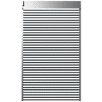

# arVenetianBlind

Venetian blind. Placed on a window (uses `WIDO_*` globals): head box, optional bottom rail, and slats that can be C-type or a custom complex profile. Slats can be lowered by a distance and tilted; optional insulation behind the blind.

**Source:** [`Library_Src/Windows/arVenetianBlind/`](../../Library_Src/Windows/arVenetianBlind/) · [Wiki](https://github.com/malamalca/ar_library/wiki/Windows)

## Parameters (main)

| Parameter | Meaning |
|-----------|---------|
| `slatAngle` | Slat tilt, −88° to 88° |
| `loweredDistance` | How far the slats are lowered |
| `railBottomOffset` | Bottom rail position |
| `boxHeight`, `boxWidth` | Head box size |
| `slatsKind` | C-type / Profile (complex profile) |
| `slatProfile`, `slatMat` | Slat profile or material |
| `bInsulation`, `insulationMat`, `insulationThickness` | Insulation behind the blind |
| `deltaFrontSideExt` | Front side extension (limited by window sill) |
| `bShowText` | Always / Never / By MVO caption text |
